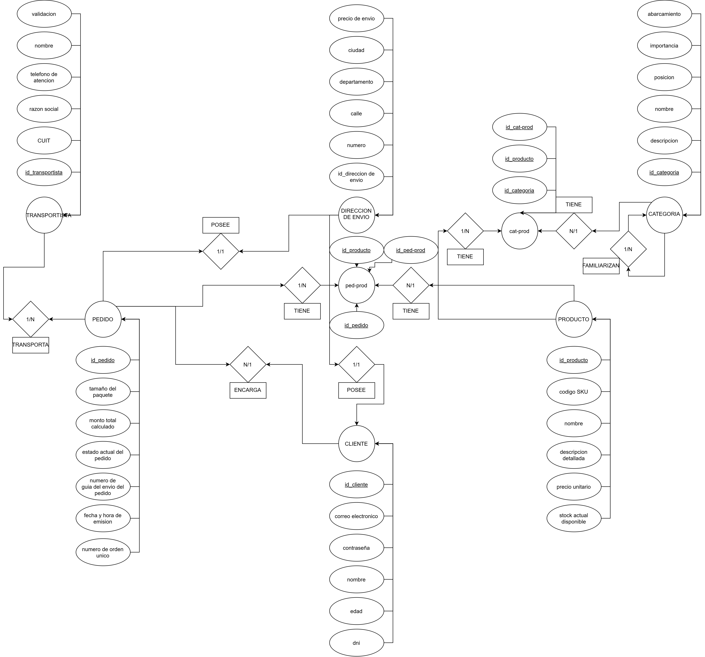

# BASE DE DATOS — Ejercicio 4: Plataforma de Comercio Electrónico y Gestión de Envíos

Trabajo práctico de Base de Datos (Universidad Champagnat). Este repositorio contiene todo el desarrollo del ejercicio 4: modelo entidad-relación, modelo relacional y normalización (1FN, 2FN y 3FN).

## Consigna


#### Contexto


Un emprendimiento de comercio electrónico de alta rotación requiere modelar su plataforma de ventas online para gestionar de manera integrada el catálogo de productos, las órdenes de compra de los clientes, los pagos y la logística de entrega a domicilio.


#### Consigna


Construir el modelo entidad-relación para el sistema de e-commerce basándose en los siguientes requerimientos:

Los productos se organizan en categorías jerárquicas (una categoría puede tener subcategorías y pertenecer a una categoría superior). Cada producto posee un código SKU, nombre, descripción detallada, precio unitario y stock actual disponible.

Los clientes se registran en la plataforma aportando su ID de cliente, correo electrónico, contraseña, nombre y múltiples direcciones de envío posibles.

Los clientes generan pedidos (órdenes de compra). Cada pedido posee un número de orden único, fecha y hora de emisión, estado actual del pedido (Pendiente, Pagado, Despachado, Entregado) y el monto total calculado.

Un pedido contiene necesariamente uno o más productos. Por cada producto incluido en el pedido se debe registrar la cantidad solicitada y el precio unitario histórico al momento de la compra.

Cada pedido es despachado a través de una empresa de logística (transportista). De cada transportista se conoce su CUIT, razón social, teléfono de atención y el número de guía o seguimiento asignado al envío del pedido.


#### Desarrollo requerido


Modelar la autorrelación recursiva para la jerarquía de Categorías de productos.

Establecer las relaciones cardinales entre Cliente, Dirección (analizando si es una entidad débil o un atributo multivaluado normalizado) y Pedido.

Resolver la relación N:M entre Pedido y Producto mediante una entidad detalle que almacene los atributos específicos de la transacción.

Incorporar la entidad Transportista y definir su asociación con la entidad Pedido según la regla de negocio de envíos.

## Estructura del repositorio

```
BASE_DE_DATOS_Ejercicio_4/
├── README.md
├── modelo-er/
│   ├── ejercicio_4.drawio        # diagrama editable (draw.io)
│   └── ejercicio_4.png           # exportación del diagrama
├── modelo-relacional/
│   ├── ejercicio_4_MR.xlsx               # modelo relacional
│   └── ejercicio_4_con_datos.xlsx        # modelo relacional con datos de ejemplo
└── normalizacion/
    ├── ejercicio_4_1FN.xlsx
    ├── ejercicio_4_2FN.xlsx
    └── ejercicio_4_3FN.xlsx
```

## Modelo entidad-relación



Archivo editable: [`modelo-er/ejercicio_4.drawio`](modelo-er/ejercicio_4.drawio).

## Modelo relacional

Tablas del modelo relacional original, antes de normalizar (`(PK)` clave primaria, `(FK)` clave foránea, `(UNIQUE)` valor único):

- **TRANSPORTISTA**: `Id_transportista(PK)`, `CUIT(UNIQUE)`, `razon social`, `telefono de atencion(UNIQUE)`, `nombre`, `validacion`
- **PEDIDO**: `Id_pedido(PK)`, `tamanio del paquete`, `monto total calculado`, `estado actual del pedido`, `n de guia del envio del pedido`, `fecha de emision`, `hora de emision`, `n de orden unico(UNIQUE)`, `Id_transportista(FK)`, `Id_direccion de envio(FK, UNIQUE)`, `precio de envio`, `Id_cliente(FK)`
- **DIRECCION DE ENVIO**: `Id_Direccion de envio(PK)`, `numero`, `calle`, `departamento(opcional)`, `ciudad`, `id_cliente(FK,UNIQUE)`
- **CLIENTE**: `Id_cliente(PK)`, `correo electronic(UNIQUE)`, `contrasenia`, `nombre`, `edad`, `dni(UNIQUE)`
- **PRODUCTO**: `Id_producto(PK)`, `codigo SKU(UNIQUE)`, `nombre`, `descripcion detallada`, `precio unitario`, `stock actual disponible`
- **CATEGORIA**: `Id_categoria(PK)`, `descripcion`, `nombre`, `posicion`, `importancia`, `abarcamiento`, `Id_categoria padre(FK →Id_categoria)`
- **CAT-PROD**: `id_cat-prod(PK)`, `id_categoria(FK, PK)`, `id_producto(FK, PK)`
- **PED-PROD**: `id_ped-prod(PK)`, `id_pedido(FK, PK)`, `id_producto(FK, PK)`

Archivos: [`ejercicio_4_MR.xlsx`](modelo-relacional/ejercicio_4_MR.xlsx) y [`ejercicio_4_con_datos.xlsx`](modelo-relacional/ejercicio_4_con_datos.xlsx).

## Lógica relacional

Cada entidad se convierte en una tabla con su clave primaria. Las relaciones se representan así:

- **1:N / N:1**: la clave primaria del lado "uno" se copia como clave foránea (FK) en la tabla del lado "muchos".
- **1:1**: igual que 1:N, pero la FK lleva restricción UNIQUE.
- **N:M**: se crea una tabla intermedia cuyas FK forman una clave compuesta, junto con una clave propia que se identifica por esa combinación.

Relaciones del modelo final (3FN):

- `PEDIDO` → `TRANSPORTISTA`: **N:1** (FK `id_transportista` en `PEDIDO`).
- `PEDIDO` → `DIRECCION DE ENVIO`: **1:1** (FK `id_direccion de envio` con UNIQUE en `PEDIDO`).
- `DIRECCION DE ENVIO` → `CLIENTE`: **1:1** (FK `id_cliente` con UNIQUE en `DIRECCION DE ENVIO`).
- `CATEGORIA` → `CATEGORIA`: **N:1** (FK `id_categoria padre` en `CATEGORIA`).
- `CATEGORIA` ↔ `PRODUCTO`: relación **N:M**, resuelta con la tabla intermedia `CAT-PROD` (sus FK forman la clave compuesta única).
- `PEDIDO` ↔ `PRODUCTO`: relación **N:M**, resuelta con la tabla intermedia `PED-PROD` (sus FK forman la clave compuesta única).

## Normalización

Los cambios se muestran etapa por etapa; cada etapa parte del resultado de la anterior.

### Primera forma normal (1FN)

Sin cambios respecto de la etapa anterior: el modelo ya cumplía esta forma normal.

### Segunda forma normal (2FN)

Sin cambios respecto de la etapa anterior: el modelo ya cumplía esta forma normal.

### Tercera forma normal (3FN)

- `PEDIDO`: se quitan `monto total calculado`, `id_cliente`

#### Modelo final en 3FN

- **TRANSPORTISTA**: `Id_transportista(PK)`, `CUIT(UNIQUE)`, `razon social`, `telefono de atencion(UNIQUE)`, `nombre`, `validacion`
- **PEDIDO**: `Id_pedido(PK)`, `tamanio del paquete`, `estado actual del pedido`, `n de guia del envio del pedido`, `fecha de emision`, `hora de emision`, `n de orden unico(UNIQUE)`, `Id_transportista(FK)`, `Id_direccion de envio(FK, UNIQUE)`, `precio de envio`
- **DIRECCION DE ENVIO**: `Id_Direccion de envio(PK)`, `numero`, `calle`, `departamento(opcional)`, `ciudad`, `id_cliente(FK,UNIQUE)`
- **CLIENTE**: `Id_cliente(PK)`, `correo electronic(UNIQUE)`, `contrasenia`, `nombre`, `edad`, `dni(UNIQUE)`
- **PRODUCTO**: `Id_producto(PK)`, `codigo SKU(UNIQUE)`, `nombre`, `descripcion detallada`, `precio unitario`, `stock actual disponible`
- **CATEGORIA**: `Id_categoria(PK)`, `descripcion`, `nombre`, `posicion`, `importancia`, `abarcamiento`, `Id_categoria padre(FK →Id_categoria)`
- **CAT-PROD**: `id_cat-prod(PK)`, `id_categoria(FK, PK)`, `id_producto(FK, PK)`
- **PED-PROD**: `id_ped-prod(PK)`, `id_pedido(FK, PK)`, `id_producto(FK, PK)`

Archivos: [`ejercicio_4_1FN.xlsx`](normalizacion/ejercicio_4_1FN.xlsx), [`ejercicio_4_2FN.xlsx`](normalizacion/ejercicio_4_2FN.xlsx), [`ejercicio_4_3FN.xlsx`](normalizacion/ejercicio_4_3FN.xlsx).
